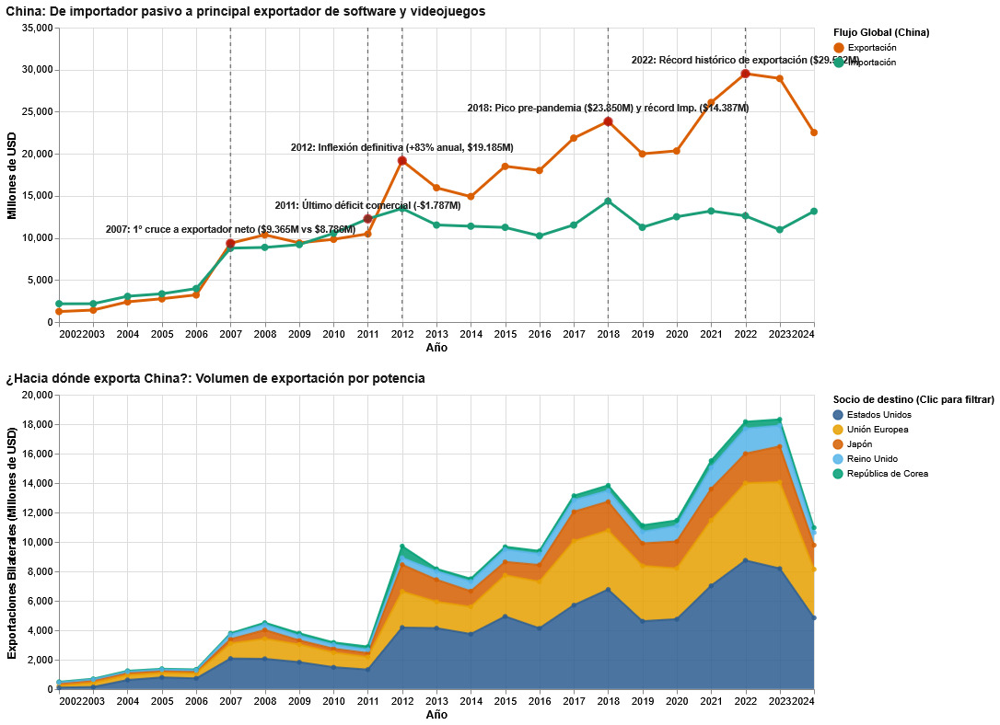

El siguiente gráfico, construido en base a los datos públicos entregados por la [United Nations Trade and Development Data Hub](https://unctadstat.unctad.org/EN/About.html), entrega un panorama general del desarrollo económico de importaciones y exportaciones de productos culturales de China, Estados Unidos, Corea, Japón, la Unión Europea y Reino Unido.

### 2012, el año clave

En el primer gráfico, que representa los flujos comerciales de importaciones y exportaciones de software y videojuegos desde y hacia China, se aprecian dos momentos claves en la historia del comercio de este tipo de bien en el gigante asiático.

El primero de todos corresponde al año **2012, donde se presenta de manera definitiva una inflexión en el flujo comercial de China.** En ese año, las exportaciones de software y videojuegos superaron en un 83% a las importaciones, con un total de 19.185 millones de dólares en total. **El dragón había despertado.**

¿Pero qué pasó exactamente ese año para que existiera un salto tan grande como ese? Las razones son múltiples.

Ese año se dio el despliegue internacional definitivo de **Tencent**, la que hoy es considerada la mayor empresa de videojuegos del planeta, más grande que cualquier otra empresa occidental. En 2012 Tencent realizó un movimiento clave; **[adquirió el 40% de Epic Games](https://as.com/meristation/2012/06/19/noticias/1340111640_104704.html)**, empresa estadounidense dueña de videojuegos como Fortnite y de [Unreal Engine](https://vandal.elespanol.com/reportaje/los-11-mejores-motores-graficos-para-introducirse-en-el-desarrollo-de-videojuegos), uno de los motores de desarrollo más poderosos y usados del mundo.

No solo fue Epic Games. Ese año, Tencent realizó la adquisición más importante del mundo del gaming: la compra de Riot Games, desarrolladora dueña del videojuego que más dinero mueve del mundo, League of Legends.

Lo interesante es que esta enorme expansión del mercado se dio inclusive cuando las consolas de videojuegos continuaban estando [totalmente prohibidas en China](https://www.bbc.com/mundo/ultimas_noticias/2014/01/140107_ultnot_china_prohibicion_consolas_videojuegos_men), prohibición que fue levantada en el año 2014, 14 años después de su implementación. Esta restricción, sin embargo, había logrado reforzar paralelamente la escena del gaming en PC.

2012 fue también un año clave para el **gaming móvil**. Aun en pañales, el sector de los videojuegos para celulares representaba ya un 5.4% del sector, liderado por [éxitos internos como lo eran Dragon Force](https://www.pocketgamer.biz/chinas-top-grossing-game-of-2012-dragon-bane-prepares-for-its-western-release/). **Este punto es clave**, ya que el desarrollo temprano de experiencias para celulares permitió cimentar las bases del *know-how* de las desarrolladoras chinas que, en un futuro, liderarían el mercado con videojuegos gacha como Genshin Impact.