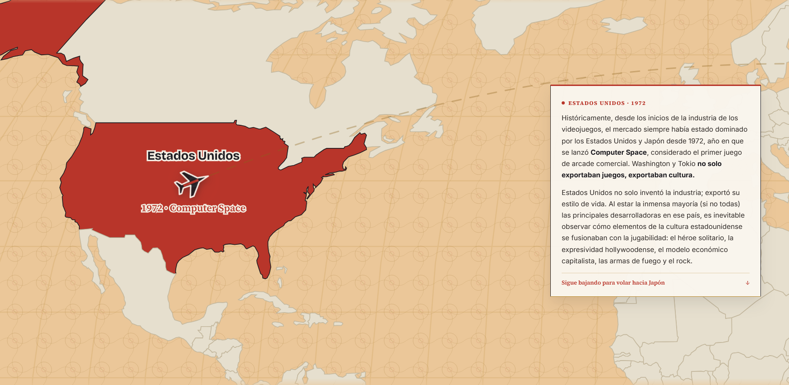
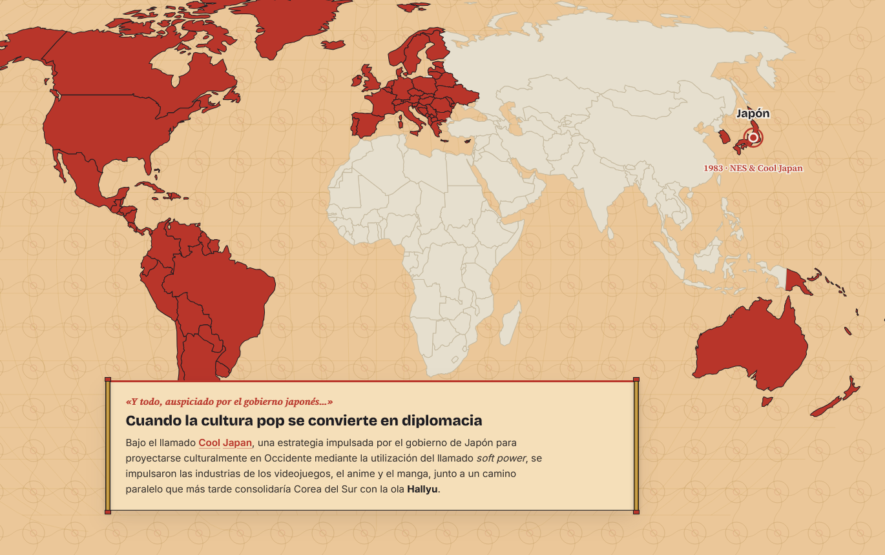
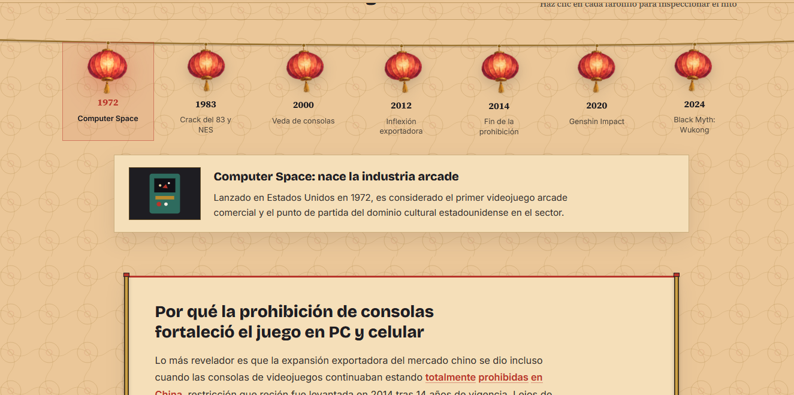
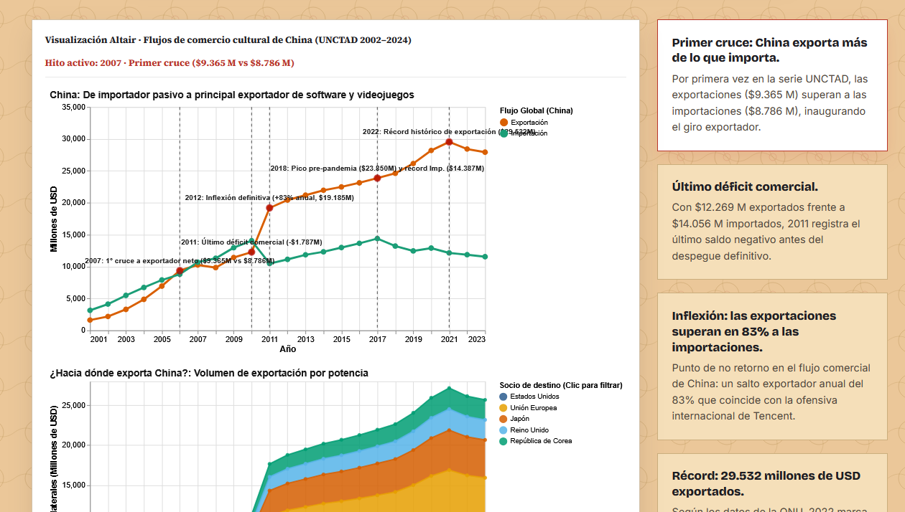
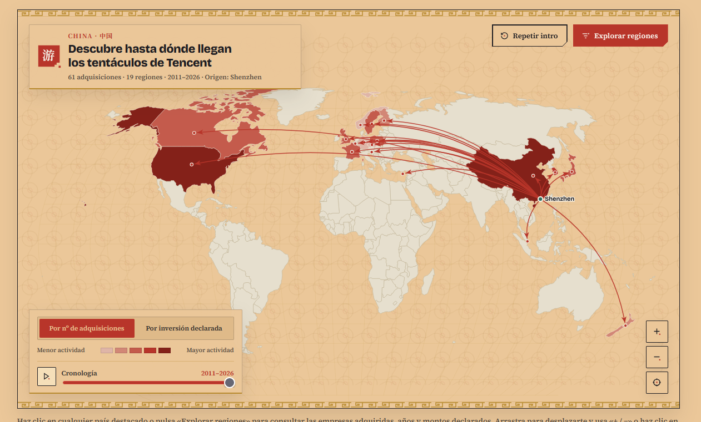

# Análisis de visualizaciones

### Visualización 1

La primera visualización cumple la función de introducir geográficamente al lector en los lugares en los que se desarrolla la historia; Estados Unidos, Japón y China. Sirve para dividir el origen de la industria de los videojuegos en Estados Unidos y qué ocurría al mismo tiempo en Asia.

La visualización fue construída enteramente en Google Ai Studio. Se le solicitó que armara un mapa mundi interactivo con scroll, utilizando como base el texto que ya tenía armado yo previamente en la crónica.

### Visualización 2

La visualización 2 cumple la función de mostrar gráficamente la influencia cultural que alcanzó Japón a comienzos y mediados de los años 80, gracias a la estrategia del llamado "Cool Japan". La idea es mostrar de manera visual un concepto abstracto como lo es el del soft power, y mostrar cómo la cultura de un país asiático "dominó" practicamente a todo Occidente.

Al igual que en la visualización 1, esta fue construida enteramente en Google Ai Studio. Se le pidio que armara un mapa mundi interactivo con scroll que mostrara ondas saliendo de Japón que se expandían hacia toda América, Oceanía y Europa.

### Visualización 3

La visualización 3 es una pequeña línea de tiempo sirve como resumen rápido de los elementos más importantes del hito 1. Fue construido igualmente con Google Ai Studio, pero las imágenes de los farolillos fueron sacadas de Canvas para evitar que los diseños se vieran "demasiado IA". Esta visualización será movida hasta el final del hito 1 porque es donde hace más sentido que esté.

### Visualización 4

La visualización 4 fue construida enteramente en Altair. La explicación detallada de su construcción fue mostrada en la entrega 02. Resume, con datos de la UNCTAD, la diferencia entre importaciones y exportaciones de productos culturales chinos catalogados bajo la categoría de Software, Video games and Recorded media de la ONU.

### Visualización 5

La visualización 5 muestra, en un mapa mundi, todos los países en los cuales Tencent posee propiedad de estudios de desarrollo de videojuegos. Posee 2 modos de visualización; por número de adquisiciones y por cantidad invertida. Aquí sale un dato interesante, y es que los países donde más tiene adquisiciones no son necesariamente los países en los que más dinero ha invertido. 

La visualización fue construida en base a la segunda base de datos realizada enteramente por mí, gracias a la búsqueda de noticias y de información de las inversiones de Tencent en diferentes medios. La parte gráfica fue armada gracias a la ayuda de Google Ai Studio, donde se le pidió que armara el mapa mundi interactivo.

### Visualización 6

La visualización 6 representa un visualizador de una selección de los videojuegos más icónicos o famosos de los cuales Tencent posee propiedad, total o parcialmente. El visualizador incluye un buscador manual para escribir el juego, el estudio o el país.

Este visualizador fue armado en base a una lista, armada íntegramente por mí, de los 5 juegos más icónicos de la decena de desarrolladoras de las cuales Tencent posee participación. A partir de eso, se le solicitó a Google Ai Studio encargarse del código.

Todas las portadas de los juegos fueron y están siendo armadas enteramente por mí, de manera manual, en Canvas. Una vez diseñadas son subidas a Google Ai Studio para que las aplique a la página. De momento llevo 71 portadas de 192 juegos en total, por lo que deben estar todas listas de cara a la entrega final.

